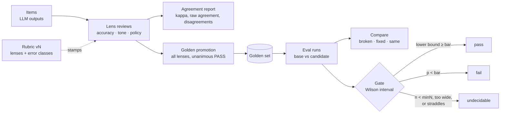

# evalroom

**You already correct scores in Inspect. evalroom tells you how often your judge was wrong, with a confidence interval.**

Human-in-the-loop quality control for LLM outputs: judge-vs-human agreement, multi-lens review, versioned rubrics, inter-rater agreement, golden sets and gated regression runs. No bare pass rate ever leaves. Python and TypeScript, same data, same numbers.

[](https://github.com/meertseker/evalroom/actions/workflows/ci.yml)
[](python/pyproject.toml)
[](https://www.npmjs.com/package/evalroom)
[](typescript/package.json)
[](LICENSE)

```text
$ evalroom judge-check examples/inspect_judge/judge_fixture.eval --scorer model_graded_qa
evalroom judge-check · inspect_judge · scorer model_graded_qa (judge mockllm/model)
80 scored samples · 60 reviewed (a human edit in Score.history) · 20 not reviewed, excluded

  Agreement      87% (52/60) · 76%–93%
  Judge wrong    13% (8/60) · 7%–24%
  Cohen's kappa  0.64  substantial
  Bar            80% agreement on the lower bound
  Decision       UNDECIDABLE
  Reason         agreement 87% meets the 80% bar but the lower bound 76% does not; collect more labels (87% (52/60) · 76%–93%)

  Judge \ Human   C   I
  ─────────────  ──  ──
  C              41   5
  I               3  11

Disagreements (8, showing 8)
  q55  judge I, human C · What is the capital of Australia? → Canberra
       judge: The submission 'It's Canberra, not Sydney.' does not state 'Canberra'. GRADE: I
       human (ana): Answer says Canberra; the extra clause is not a different answer.
  q68  judge C, human I · What is the chemical symbol for silver? → Ag
       judge: The submission 'Au' matches the criterion 'Ag'. GRADE: C
       human (chen): Au is gold. Silver is Ag.
  ...

Warning: do not trust this judge on this evidence yet.
$ echo $?
2
```

That log is a real Inspect log ([python/examples/inspect_judge](python/examples/inspect_judge)): 80 questions graded by `model_graded_qa`, 60 of them checked by people who confirmed or corrected the grade with `edit_score`. The judge agreed with them 87% of the time, but on 60 labels the interval still reaches down to 76%, so evalroom will not call it good enough for an 80% bar yet.

## Install

```sh
pip install evalroom                # core: zero dependencies, Python 3.10+
pip install "evalroom[inspect]"     # Inspect extension (inspect_ai needs Python 3.11+)
pip install "evalroom[pandas]"      # to_dataframe() helpers
```

TypeScript: `npm install evalroom` (see [TypeScript](#typescript)).

## Check your LLM judge in Inspect

1. Run your eval as usual. Any scorer works; `model_graded_qa` is the common case.
2. Correct the grades you disagree with, and confirm the ones you checked, in the Inspect log viewer or with `inspect_ai.log.edit_score(...)`. Inspect keeps the judge's original grade in `Score.history` and records who edited it and why.
3. Ask evalroom how often the judge was right:

```sh
evalroom judge-check logs/my-task.eval                     # 0 acceptable, 1 not, 2 undecidable
evalroom judge-check logs/my-task.eval --human labels.csv  # labels from a file instead of edits
evalroom gate logs/my-task.eval --threshold 0.9            # gate the eval itself, using the corrections
evalroom compare logs/before.eval logs/after.eval          # broken / fixed / same, sample by sample
```

The same from Python:

```python
from evalroom.inspect import judge_check

report = judge_check("logs/my-task.eval", scorer="model_graded_qa")
print(report.agreement)        # 87% (52/60) · 76%–93%
print(report.kappa.value, report.decision, report.warning)
report.to_dict()               # the --json output
```

What counts as evidence:

- a score whose `Score.history` holds an entry with provenance is **reviewed**: the judge's label is the original value, the human label is the current value, and an edit that keeps the value is a **confirmation**;
- scores nobody touched are **not reviewed** and are excluded (the count is reported). `--assume-unedited-agree` counts them as agreements; it is off by default and labelled whenever it is on, because "nobody complained" is not a review;
- partial credit (`P`) counts as incorrect by default; `--partial pass` or `--partial exclude` change that;
- the decision uses the same rule as every gate in evalroom: **undecidable** below 50 labels, when the 95% interval is wider than 25 points, or when it straddles the bar; **acceptable** only when the interval's lower bound clears `--min-agreement` (default 0.8).

For more detail (how many labels you need, kappa versus raw agreement, reading the confusion matrix, running it in CI), see [docs/validate-your-llm-judge.md](docs/validate-your-llm-judge.md).

### A metric that carries its interval

```python
from inspect_ai import Task
from inspect_ai.scorer import accuracy, model_graded_qa
from evalroom.inspect import wilson_accuracy

Task(dataset=..., solver=..., scorer=model_graded_qa(),
     metrics=[accuracy(), wilson_accuracy()])   # wilson_accuracy, lower, upper, decidable, n
```

The metric is also registered with Inspect as `evalroom/wilson_accuracy`.

## Why

Human graders disagree with each other far more often than anyone checks, and LLM judges disagree with humans in ways nobody measures. Teams then report a pass rate on twelve items as if it were a measurement, and ship the next prompt or model change because the number went from 75% to 83%. On twelve items that difference is noise, and the judge or the people who graded it may not have been grading the same thing.

evalroom gives you:

- **Judge validation.** Agreement between an LLM judge and the humans who corrected it, with an interval, Cohen's kappa, a confusion matrix and the disagreements to read.
- **Multi-lens review.** Each output is graded through named lenses (for example `accuracy`, `tone`, `policy`). An item only counts once every lens has a current verdict; the latest review per (item, lens) wins.
- **Versioned rubrics.** Error classes with include/exclude rules, validated at definition time. Every review carries the rubric version, and agreement is never computed across versions.
- **Agreement you can read.** Raw agreement, Fleiss' kappa, Cohen's kappa per lens pair, confusion per pair, prevalence, median review time, the disagreements, and a Landis & Koch interpretation with its caveats. Below 10 complete items kappa is withheld with a reason.
- **Golden promotion with preconditions.** An item becomes a golden case only if every lens is present, every verdict is PASS (by default), and the expected rules pass on the reviewed output. Refusals list every reason.
- **Gated regression runs.** Score outputs against the golden set, partition cases into broken / fixed / same, and gate on the Wilson interval: `pass`, `fail` or `undecidable`. Nothing decides below `min_n = 50` or above an interval width of `0.25`.
- **No bare rates.** Every rate is an `Interval` with `p`, `low`, `high`, `k`, `n` and `decidable`.

Zero runtime dependencies in the core. No database: pure functions over plain data, plus small store interfaces with in-memory and JSONL implementations.

## Core concepts



| Term        | Meaning                                                                                                      |
| ----------- | ------------------------------------------------------------------------------------------------------------ |
| Item        | One LLM output under review: `{ id, output, input?, meta?, tenant? }`                                        |
| Lens        | A reviewer perspective declared by the rubric. An item is _complete_ when every lens has a current verdict   |
| Verdict     | `PASS`, `FAIL` or `NEEDS_REVIEW`                                                                             |
| Review      | One verdict through one lens, stamped with reviewer, rubric version and time. Latest per (item, lens) wins   |
| Rubric      | `{ version, lenses, errorClasses }`. Bump the version when an include/exclude rule changes meaning           |
| Golden case | A frozen, unanimously passed item plus the rules future outputs must satisfy, with provenance to the reviews |
| Eval run    | One case result per golden case for one prompt/model configuration                                           |
| Gate        | A pass / fail / undecidable decision on a run's pass-rate interval                                           |
| Calibration | A versioned configuration (prompt, model, thresholds) with draft, four-eyes activation and rollback          |

More in [docs/concepts.md](docs/concepts.md).

```python
from evalroom import (
    ErrorClassDef, Ok, PathRule, agreement_report, define_rubric, format_interval, gate,
    promote_to_golden, score_run,
)

rubric = define_rubric(
    version="2026-10.1",
    lenses=["accuracy", "tone"],
    error_classes=[ErrorClassDef(code="WRONG_FACT", label="Wrong fact", lenses=("accuracy",),
                                 include="States something false.", exclude="Incomplete but not false.")],
)

report = agreement_report(reviews, rubric)      # reviews: list[Review]
print(report.fleiss_kappa, format_interval(report.raw_agreement))

promoted = promote_to_golden(item, reviews, rubric=rubric, promoted_by="qa-lead",
                             expected_rules=[PathRule("reply", "notContains", ["guarantee"])])
if not isinstance(promoted, Ok):
    raise SystemExit("; ".join(r.message for r in promoted.error))
run = score_run([promoted.value], {promoted.value.id: new_output}, id="c1", label="prompt-v4")
print(gate(run, min_pass_rate=0.9).reason)      # "n=1 is below minN=50 (...)"
```

## Command line

The same `evalroom` command ships with both packages. On the bundled support-replies data (20 customer-support replies, 63 reviews, 3 lenses):

```sh
cd conformance/data
evalroom agreement reviews.jsonl --rubric rubric.json
evalroom golden promote t-01 --items items.jsonl --reviews reviews.jsonl \
  --rubric rubric.json --rules rules-t-01.json --out my-golden.jsonl
evalroom score golden.jsonl outputs-candidate.jsonl --out run.jsonl --label reply-v4
evalroom compare run-base.jsonl run-candidate.jsonl
evalroom gate run-candidate.jsonl --min-pass 0.8; echo "exit $?"   # exit 2: undecidable at n=11
```

| Command                                                                                 | Does                                                   | Exit code                           |
| --------------------------------------------------------------------------------------- | ------------------------------------------------------ | ----------------------------------- |
| `agreement <reviews.jsonl> --rubric <rubric.json> [--version v] [--min-items n]`        | Agreement report for one rubric version                | 0                                   |
| `gate <run.jsonl \| log.eval> [--min-n 50] [--max-width 0.25] [--min-pass 0.9]`         | Gate a run or an Inspect log on its pass-rate interval | 0 pass, 1 fail, 2 undecidable       |
| `compare <base> <candidate>`                                                            | Broken / fixed / same partition (run files or logs)    | 0, or 1 if any case broke           |
| `golden promote <item-id> --items --reviews --rubric --out [--rules] [--by] [--audit]`  | Promote a reviewed item, or list refusals              | 0, or 1 if refused                  |
| `score <golden.jsonl> <outputs.jsonl> --out <run.jsonl>`                                | Score `{caseId, output}` lines into a run file         | 0                                   |
| `judge-check <log.eval> [--scorer] [--human labels] [--partial] [--min-agreement 0.8]`  | Judge vs human agreement on an Inspect log (Python)    | 0 acceptable, 1 not, 2 undecidable  |

Every command takes `--json`. Usage errors exit 64, missing or malformed input exits 65 with `file:line` in the message. Inspect logs are recognised by the `.eval` extension or the shape of a `.json` file; without the extra, those commands exit 64 with an install hint. Colour follows the TTY and respects `NO_COLOR` / `FORCE_COLOR`.

## Statistics, honestly

- **Wilson, not Wald.** The textbook `p ± 1.96·sqrt(p(1-p)/n)` interval says 0/20 is "0%–0%" and 19/20 is "85%–105%". The Wilson score interval stays inside [0, 1] and has close to nominal coverage at small n. At 12/20 it is 39%–78%, which is the honest answer.
- **`min_n` and `max_width` gate every decision.** A rate is `decidable` only with at least 50 trials and an interval no wider than 25 points. At p = 0.8 that first happens around n = 50 (67%–89%). Below that, a gate returns `undecidable` in both directions: 11 cases cannot pass, and they cannot fail either.
- **Kappa needs 10 items** before it is printed, and the interpretation says "provisional" below 50. Landis & Koch bands are a convention, not a law. Kappa drops when one label dominates (the prevalence paradox), which is why raw agreement is always shown next to it.
- **What the numbers do not tell you.** A judge that agrees with reviewers on the samples they chose to look at may do worse on the ones they skipped; review a random sample, not only the suspicious ones. Fleiss' kappa across lenses measures whether lenses converge on one verdict; lenses that grade different things are _expected_ to disagree. A golden set built from unanimous PASS items is biased towards easy cases, so its pass rate is not your production pass rate.

The full argument, with the width table and references, is in [docs/statistics.md](docs/statistics.md).

## TypeScript

```sh
npm install evalroom
```

```ts
import { agreementReport, defineRubric, formatInterval, gate, promoteToGolden, scoreRun } from "evalroom";

const rubric = defineRubric({
  version: "2026-10.1",
  lenses: ["accuracy", "tone"],
  errorClasses: [{ code: "WRONG_FACT", label: "Wrong fact", lenses: ["accuracy"],
    include: "States something false.", exclude: "Incomplete but not false." }],
});

const report = agreementReport(reviews, rubric);
console.log(report.fleissKappa, formatInterval(report.rawAgreement));
console.log(gate(run, { minPassRate: 0.9 }));   // { decision: "undecidable", reason: "n=1 is below minN=50 ..." }
```

ESM and CommonJS builds with type declarations, Node 20+, zero runtime dependencies. The package lives in [typescript/](typescript); `judge-check` and the Inspect extension are Python-only, because Inspect is.

### Same data, same numbers, two languages

Files written by one implementation are read by the other: reviews, rubrics, golden sets and run files use the same JSON with the same camelCase keys, and `evalroom score` writes the same result lines in both. [conformance/](conformance) holds the shared test vectors: inputs and expected outputs for the statistics, agreement, rules, golden promotion, eval runs, gate and calibration, plus the expected `--json` output and exit code of every CLI command. They are generated from the TypeScript implementation (`npm run conformance:generate`), the published-value cases are written by hand, and both test suites must reproduce every vector (floats within 1e-9).

## Where this comes from

evalroom was extracted from the "control room" built and run in production at Revint, where it graded an LLM sales-decision pipeline through three reviewer lenses. Reviewers recorded one verdict per lens, disagreements were adjudicated, reviewed outputs were promoted to a golden set, and every prompt or model change was replayed against that set before it shipped.

The statistics, the rubric versioning and the golden promotion flow are the parts that survived contact with real graders, and they are what this library keeps. The domain scoring was replaced by a generic rule engine; the database, roles and UI were left behind. [docs/design.md](docs/design.md) lists what was kept, what was dropped and why.

## How it compares

|                                  | evalroom                                                   | Inspect                                         | promptfoo                                     | Braintrust                                        | Langfuse                                       |
| -------------------------------- | ---------------------------------------------------------- | ----------------------------------------------- | --------------------------------------------- | ------------------------------------------------- | ---------------------------------------------- |
| What it is                       | Library + CLI for review statistics and process            | Open-source framework for running LLM evals     | Open-source CLI/library for prompt testing    | Hosted evaluation and observability platform      | Open-source LLM observability and evaluation   |
| Main scoring mode                | Human verdicts per lens; judge-vs-human agreement; rules   | Scorers, including model-graded; score editing  | Assertions and LLM-as-judge                   | Code and LLM scorers, plus human review in the UI | LLM-as-judge, custom scores, annotation queues |
| Judge validated against humans   | Agreement interval, kappa, confusion, disagreements        | Edits recorded in score history                 | Not its focus                                 | Not its focus                                     | Not its focus                                  |
| Intervals on every rate          | Yes, Wilson, with a decidability flag                      | Mean and standard error                         | Raw pass rates                                | Score summaries and comparisons                   | Score dashboards                               |
| Runtime dependencies             | 0 (Inspect and pandas optional)                            | Python packages                                 | Many                                          | SDK + service                                     | SDK + service                                  |

These tools solve different problems and compose: evalroom reads Inspect logs rather than replacing Inspect, and works next to promptfoo, Braintrust or Langfuse for the human-review statistics and the ship gate. Descriptions are based on each project's public documentation at the time of writing; corrections are welcome.

## Roadmap

Next up: adjudication of disagreements, bootstrap intervals for kappa, Krippendorff's alpha for missing lenses, a paired test for base vs. candidate, and stratified judge checks per category. See [ROADMAP.md](ROADMAP.md).

## Contributing

Issues and pull requests are welcome. Read [CONTRIBUTING.md](CONTRIBUTING.md) first; statistics changes need a test against a published or hand-computed value, and behaviour changes need both implementations and a conformance vector. Security reports go through [SECURITY.md](SECURITY.md). This project follows the [Contributor Covenant](CODE_OF_CONDUCT.md).

## License

[MIT](LICENSE) © 2026 Mert Seker
