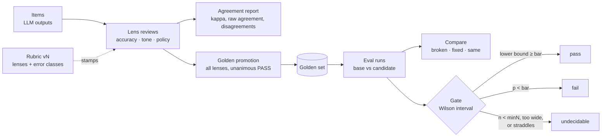

# evalroom

Human-in-the-loop quality control for LLM outputs: multi-lens review, versioned rubrics, inter-rater agreement, golden sets and gated regression runs. No bare pass rate ever leaves.

[](https://github.com/meertseker/evalroom/actions/workflows/ci.yml)
[](https://www.npmjs.com/package/evalroom)
[](LICENSE)
[](package.json)

```text
$ evalroom agreement examples/support-replies/reviews.jsonl --rubric examples/support-replies/rubric.json
evalroom agreement · rubric 2026-10.1 · lenses accuracy, tone, policy
19 complete items · 1 incomplete · 2 reviews from other rubric versions excluded

  Fleiss' kappa  0.06  slight
  Raw agreement  58% (11/19) · 36%–77% · not decidable
  Median review  64s  (accuracy 99s · tone 42s · policy 62s)

  Lens pair          Agreement                              Cohen's kappa
  ─────────────────  ─────────────────────────────────────  ─────────────
  accuracy × tone    74% (14/19) · 51%–88% · not decidable  0.17  slight
  accuracy × policy  74% (14/19) · 51%–88% · not decidable  0.15  slight
  tone × policy      68% (13/19) · 46%–85% · not decidable  -0.15  poor

Disagreements (8)
  Item  accuracy              tone                  policy
  ────  ────────────────────  ────────────────────  ────────────────────────
  t-03  PASS                  FAIL DISMISSIVE_TONE  PASS
  t-05  FAIL POLICY_MISQUOTE  PASS                  FAIL POLICY_MISQUOTE
  t-09  FAIL WRONG_FACT       PASS                  PASS
  ...

Fleiss' kappa 0.06 across 3 lenses on 19 complete items: slight agreement (Landis & Koch).
PASS is 82% of verdicts; kappa is depressed when one verdict dominates, so read raw agreement
alongside it. With 19 items the kappa itself is noisy; treat the band as provisional.
```

## Why

Human graders disagree with each other far more often than anyone checks. Teams then report a pass rate on twelve items as if it were a measurement, and ship the next prompt or model change because the number went from 75% to 83%. On twelve items that difference is noise, and the people who graded it may not have been grading the same thing.

evalroom gives you:

- **Multi-lens review.** Each output is graded through named lenses (for example `accuracy`, `tone`, `policy`). An item only counts once every lens has a current verdict; the latest review per (item, lens) wins.
- **Versioned rubrics.** Error classes with include/exclude rules, validated at definition time. Every review carries the rubric version, and agreement is never computed across versions.
- **Agreement you can read.** Raw agreement, Fleiss' kappa, Cohen's kappa per lens pair, a confusion matrix per pair, prevalence, median review time, the list of disagreements, and a Landis & Koch interpretation with its caveats. Below 10 complete items kappa is `null` with a reason.
- **Golden promotion with preconditions.** An item becomes a golden case only if every lens is present, every verdict is PASS (by default), and the expected rules pass on the reviewed output. Refusals list every reason.
- **Gated regression runs.** Score a new prompt's outputs against the golden set, partition cases into broken / fixed / same, and gate on the Wilson interval: `pass`, `fail` or `undecidable`. Nothing decides below `minN = 50` or above an interval width of `0.25`.
- **No bare rates.** Every rate the library returns is an `Interval` with `p`, `low`, `high`, `k`, `n` and `decidable`.

Zero runtime dependencies. No database: pure functions over plain data, plus a small `EvalStore` interface with in-memory and JSONL implementations.

## Quickstart

```sh
npm i evalroom
```

```ts
import { agreementReport, defineRubric, formatInterval, gate, promoteToGolden, scoreRun } from "evalroom";

const rubric = defineRubric({
  version: "2026-10.1",
  lenses: ["accuracy", "tone"],
  errorClasses: [{ code: "WRONG_FACT", label: "Wrong fact", lenses: ["accuracy"],
    include: "States something false.", exclude: "Incomplete but not false." }],
});

const report = agreementReport(reviews, rubric);       // reviews: Review[] from your review tool
console.log(report.fleissKappa, formatInterval(report.rawAgreement));

const promoted = promoteToGolden(item, reviews, { rubric, promotedBy: "qa-lead",
  expectedRules: [{ path: "reply", op: "notContains", value: ["guarantee"] }] });
if (!promoted.ok) throw new Error(promoted.error.map((r) => r.message).join("; "));

const run = scoreRun([promoted.value], { [promoted.value.id]: newOutput }, { id: "c1", label: "prompt-v4" });
console.log(gate(run, { minPassRate: 0.9 }));          // { decision: "undecidable", reason: "n=1 is below minN=50 ..." }
```

The same flow from the command line, on the bundled example (20 customer-support replies, 63 reviews, 3 lenses):

```sh
cd examples/support-replies
npx evalroom agreement reviews.jsonl --rubric rubric.json
npx evalroom golden promote t-01 --items items.jsonl --reviews reviews.jsonl \
  --rubric rubric.json --rules rules-t-01.json --out my-golden.jsonl
npx evalroom score golden.jsonl outputs-candidate.jsonl --out run.jsonl --label reply-v4
npx evalroom compare run-base.jsonl run-candidate.jsonl
npx evalroom gate run-candidate.jsonl --min-pass 0.8; echo "exit $?"   # exit 2: undecidable at n=11
```

Or run the whole walkthrough from a clone with `npm run example`.

| Command                                                                                | Does                                           | Exit code                     |
| -------------------------------------------------------------------------------------- | ---------------------------------------------- | ----------------------------- |
| `agreement <reviews.jsonl> --rubric <rubric.json> [--version v] [--min-items n]`       | Agreement report for one rubric version        | 0                             |
| `gate <run.jsonl> [--min-n 50] [--max-width 0.25] [--min-pass 0.9]`                    | Gate a run on its pass-rate interval           | 0 pass, 1 fail, 2 undecidable |
| `compare <base.jsonl> <candidate.jsonl>`                                               | Broken / fixed / same partition                | 0, or 1 if any case broke     |
| `golden promote <item-id> --items --reviews --rubric --out [--rules] [--by] [--audit]` | Promote a reviewed item, or list refusals      | 0, or 1 if refused            |
| `score <golden.jsonl> <outputs.jsonl> --out <run.jsonl>`                               | Score `{caseId, output}` lines into a run file | 0                             |

Every command takes `--json`. Usage errors exit 64, missing or malformed input exits 65 with `file:line` in the message. Colour follows the TTY and respects `NO_COLOR` / `FORCE_COLOR`.

## Concepts



| Term        | Meaning                                                                                                      |
| ----------- | ------------------------------------------------------------------------------------------------------------ |
| Item        | One LLM output under review: `{ id, output, input?, meta?, tenant? }`                                        |
| Lens        | A reviewer perspective declared by the rubric. An item is _complete_ when every lens has a current verdict   |
| Verdict     | `PASS`, `FAIL` or `NEEDS_REVIEW`                                                                             |
| Review      | One verdict through one lens, stamped with reviewer, rubric version and time. Latest per (item, lens) wins   |
| Rubric      | `{ version, lenses, errorClasses }`. Bump the version when an include/exclude rule changes meaning           |
| Golden case | A frozen, unanimously passed item plus the rules future outputs must satisfy, with provenance to the reviews |
| Eval run    | One `CaseResult` per golden case for one prompt/model configuration                                          |
| Gate        | A pass / fail / undecidable decision on a run's pass-rate interval                                           |
| Calibration | A versioned configuration (prompt, model, thresholds) with draft, four-eyes activation and rollback          |

More in [docs/concepts.md](docs/concepts.md).

## API reference

| Function                                                             | Returns                                                                               |
| -------------------------------------------------------------------- | ------------------------------------------------------------------------------------- |
| `wilson(k, n, { z, minN, maxWidth })`                                | `Interval`: `{ p, low, high, k, n, decidable }`                                       |
| `formatRate(k, n)` / `formatInterval(i)`                             | `"60% (12/20) · 39%–78% · not decidable"`                                             |
| `median(values)`                                                     | `number \| null`                                                                      |
| `fleissKappa(rows)` / `cohenKappa(a, b)`                             | `number \| null` (null when undefined)                                                |
| `interpretKappa(k)`                                                  | Landis & Koch band: `"poor"` … `"almost perfect"`, or `null`                          |
| `defineRubric(input)` / `parseRubric(json)`                          | Frozen `Rubric` (throws `RubricError`) / `Result<Rubric, string[]>`                   |
| `validateReview(input, { rubric })` / `parseItem(input)`             | `Result<Review, string[]>` / `Result<Item, string[]>`                                 |
| `latestPerLens(reviews, lenses)` / `missingLenses(...)`              | Current review per lens / lenses without one                                          |
| `completeItems(reviews, lenses)` / `incompleteItems(...)`            | Items with every lens / items still missing some                                      |
| `agreementReport(reviews, rubric, { rubricVersion, minItems })`      | `AgreementReport`                                                                     |
| `scoreOutput(output, rules)` / `evaluateRule(output, rule)`          | `{ passed, failures: { code, path, detail }[] }` / one failure or `null`              |
| `custom(code, check)` / `parseRules(json)`                           | `CustomRule` / `Result<PathRule[], string[]>`                                         |
| `getPath(value, path)` / `normalizeText(s)` / `containsPhrase(h, n)` | Rule-engine helpers                                                                   |
| `promoteToGolden(item, reviews, opts)`                               | `Result<GoldenCase, PromotionRefusal[]>`                                              |
| `promoteAndRecord(item, reviews, opts, audit)`                       | Same, and appends a `golden.promote` audit event on success                           |
| `scoreRun(cases, outputs, { id, label })`                            | `EvalRun` (missing outputs fail as `MISSING_OUTPUT`)                                  |
| `summarize(run)`                                                     | `{ total, passed, failed, passRate: Interval, failuresByCode }`                       |
| `compareRuns(base, candidate)`                                       | `{ broken, fixed, same, onlyInBase, onlyInCandidate, baseSummary, candidateSummary }` |
| `gate(run, { minPassRate, minN, maxWidth })`                         | `{ decision, interval, minPassRate, reason }`                                         |
| `snapshot(config)` / `diffValues(before, after)`                     | Frozen key-sorted copy / `["retry.max: 3 → 5", ...]`                                  |
| `createDraft` / `activate` / `rollback(store, input, audit?)`        | `Result<CalibrationVersion, CalibrationRefusal>`                                      |
| `MemoryStore`, `JsonlStore(dir)`                                     | `EvalStore` + `CalibrationStore` implementations                                      |
| `MemoryAuditSink`, `JsonlAuditSink(path)`                            | `AuditSink` implementations                                                           |
| `parseJsonl`, `readRunFile`, `writeRunFile`, `formatRunJsonl`        | JSONL and run-file helpers                                                            |

Rule operators: `eq`, `neq`, `in`, `notIn`, `between`, `contains`, `notContains`, `matches`, `notMatches`, `subsetOf`, `exists`. Text checks fold case, diacritics, punctuation and whitespace and match whole phrases (`"refund"` does not match `"refundable"`). A path that does not resolve fails every operator except `exists`.

Everything is typed (no `any` in public types) and documented with JSDoc. ESM and CommonJS builds ship with type declarations.

## Statistics, honestly

- **Wilson, not Wald.** The textbook `p ± 1.96·sqrt(p(1-p)/n)` interval says 0/20 is "0%–0%" and 19/20 is "85%–105%". The Wilson score interval stays inside [0, 1] and has close to nominal coverage at small n. At 12/20 it is 39%–78%, which is the honest answer.
- **`minN` and `maxWidth` gate every decision.** A rate is `decidable` only with at least 50 trials and an interval no wider than 25 points. At p = 0.8 that first happens around n = 50 (67%–89%). Below that, `gate` returns `undecidable` in both directions: a run of 11 cases cannot pass, and it cannot fail either.
- **Kappa needs 10 complete items** before it is printed at all, and the interpretation says "provisional" below 50. Landis & Koch bands are a convention, not a law.
- **What the numbers do not tell you.** Fleiss' kappa across lenses measures whether lenses converge on one verdict; lenses that grade different things (tone vs. policy) are _expected_ to disagree, as in the example above. To measure whether one lens is graded reliably, have two people grade the same lens and use `cohenKappa`. Kappa drops when one verdict dominates (the prevalence paradox), so the report flags it. Prevalence intervals treat verdicts as independent although they cluster by item. A golden set built from unanimous PASS items is biased towards easy cases, so its pass rate is not your production pass rate.

The full argument, with the width table and references, is in [docs/statistics.md](docs/statistics.md).

## Where this comes from

evalroom was extracted from the "control room" built and run in production at Revint, where it graded an LLM sales-decision pipeline through three reviewer lenses. Reviewers recorded one verdict per lens, disagreements were adjudicated, reviewed outputs were promoted to a golden set, and every prompt or model change was replayed against that set before it shipped.

The statistics, the rubric versioning and the golden promotion flow are the parts that survived contact with real graders, and they are what this library keeps. The domain scoring, which checked recommendations specific to that product, was replaced by a generic rule engine; the database, roles and UI were left behind. [docs/design.md](docs/design.md) lists what was kept, what was dropped and why.

## How it compares

|                                  | evalroom                                              | promptfoo                                                            | Braintrust                                        | Langfuse                                                                   | Spreadsheet        |
| -------------------------------- | ----------------------------------------------------- | -------------------------------------------------------------------- | ------------------------------------------------- | -------------------------------------------------------------------------- | ------------------ |
| What it is                       | Library + CLI for human-review statistics and process | Open-source CLI/library for prompt and model testing and red teaming | Hosted evaluation and observability platform      | Open-source LLM observability and evaluation platform (self-host or cloud) | Whatever you build |
| Main scoring mode                | Human verdicts per lens; rule checks on golden cases  | Assertions and LLM-as-judge                                          | Code and LLM scorers, plus human review in the UI | LLM-as-judge, custom scores, annotation queues                             | Manual             |
| Inter-rater agreement            | Fleiss and Cohen kappa, confusion, disagreements      | Not its focus                                                        | Not its focus                                     | Not its focus                                                              | DIY formulas       |
| Intervals on every rate          | Yes, Wilson, with a decidability flag                 | Raw pass rates                                                       | Score summaries and comparisons                   | Score dashboards                                                           | DIY                |
| Rubric versioning                | Built in, enforced on agreement                       | Prompt/config versioning                                             | Experiment and prompt versioning                  | Prompt versioning                                                          | By convention      |
| Tracing, dashboards, datasets UI | No                                                    | Local web viewer                                                     | Yes                                               | Yes                                                                        | No                 |
| Runtime dependencies             | 0                                                     | Many                                                                 | SDK + service                                     | SDK + service                                                              | None               |

These tools solve different problems and compose: run promptfoo, Braintrust or Langfuse for automated scoring and tracing, and use evalroom for the human-review statistics and the ship gate. Descriptions are based on each project's public documentation at the time of writing; corrections are welcome.

## Roadmap

Next up: adjudication of disagreements, bootstrap intervals for kappa, Krippendorff's alpha for missing lenses, a paired test for base vs. candidate, and a browser-safe entry point without `node:fs`. See [ROADMAP.md](ROADMAP.md).

## Contributing

Issues and pull requests are welcome. Read [CONTRIBUTING.md](CONTRIBUTING.md) first; statistics changes need a test against a published or hand-computed value. Security reports go through [SECURITY.md](SECURITY.md). This project follows the [Contributor Covenant](CODE_OF_CONDUCT.md).

## License

[MIT](LICENSE) © 2026 Mert Seker
