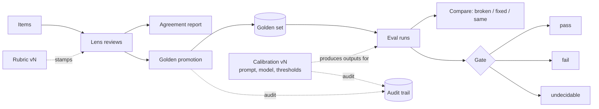

# Concepts

evalroom has a small, fixed vocabulary. The code, the CLI and these docs use the same words.



## Item

One LLM output under review.

```ts
interface Item {
  id: string;
  output: unknown;
  input?: unknown;
  meta?: Record<string, unknown>;
  tenant?: string;
}
```

`output` and `input` are any JSON value. `tenant` is an optional tag for callers that serve several customers from one store; evalroom never filters on it implicitly, the store filters accept it explicitly.

## Lens

A reviewer perspective, such as `accuracy`, `tone` or `policy`. The rubric declares its lenses. Lenses exist because a single "is this good?" verdict mixes questions that different people answer differently: a support lead can judge tone in 40 seconds, while checking a fact against the order system takes two minutes and a different person.

An item is **complete** when every lens has a current verdict. Only complete items enter agreement statistics and golden promotion.

## Verdict

`PASS`, `FAIL` or `NEEDS_REVIEW`. `NEEDS_REVIEW` is a real answer ("I cannot decide this with what I have"), not a missing one, and it counts in agreement.

## Review

```ts
interface Review {
  id: string;
  itemId: string;
  lens: string;
  verdict: "PASS" | "FAIL" | "NEEDS_REVIEW";
  errorClass?: string;
  severity?: "low" | "medium" | "high";
  note?: string;
  seconds?: number;
  reviewer: string;
  rubricVersion: string;
  createdAt: string;
  tenant?: string;
}
```

Reviews are append-only. When a reviewer changes their mind, or a second reviewer re-checks, a new review is written; `latestPerLens` picks the one with the latest `createdAt` per lens (append order breaks ties). History is never overwritten.

`validateReview` enforces that a `FAIL` carries an error class, a severity and a note (disable with `requireFailDetails: false`), and, when given the rubric, that the lens and error class exist and belong together.

## Rubric

```ts
const rubric = defineRubric({
  version: "2026-10.1",
  lenses: ["accuracy", "tone", "policy"],
  errorClasses: [
    {
      code: "POLICY_MISQUOTE",
      label: "Policy misquoted",
      lenses: ["accuracy", "policy"],
      include: "States a policy term that differs from the published policy.",
      exclude: "A promise beyond policy, without misquoting it, is UNSUPPORTED_PROMISE.",
      goodExample: "Our return window is 30 days.",
      badExample: "Our return window is 60 days.",
    },
  ],
});
```

`defineRubric` checks unique lenses, unique error-class codes, non-empty rules, and that every error class references declared lenses. It returns a frozen object with literal types. `parseRubric` does the same for JSON and returns a `Result`.

**Bump the version whenever an include or exclude rule changes meaning.** Reviews written against different versions answered different questions, so `agreementReport` only ever uses one version (by default `rubric.version`) and reports how many reviews it excluded.

## Agreement report

`agreementReport(reviews, rubric)` returns, for complete items of one rubric version:

| Field                                         | Meaning                                                                     |
| --------------------------------------------- | --------------------------------------------------------------------------- |
| `items`, `incompleteItems`, `excludedReviews` | What was counted and what was not                                           |
| `rawAgreement`                                | Share of items where every lens agreed, as an `Interval`                    |
| `fleissKappa`                                 | Fleiss' kappa with lenses as raters: `{ value, band, n, reason? }`          |
| `pairs[]`                                     | Per lens pair: agreement `Interval`, Cohen's kappa, 3×3 confusion matrix    |
| `prevalence`                                  | Share of PASS / FAIL / NEEDS_REVIEW among current verdicts, as intervals    |
| `medianSeconds`, `medianSecondsByLens`        | Review time, from reviews that recorded `seconds`                           |
| `disagreements[]`                             | Every complete item where the lenses split, with each lens's class and note |
| `interpretation`                              | One sentence with the Landis & Koch band and the caveats that apply         |

Below `minItems` (default 10) complete items, every kappa is `null` with a `reason`.

## Golden case

```ts
interface GoldenCase {
  id: string;
  itemId: string;
  input: unknown;
  referenceOutput: unknown;
  expectedRules: PathRule[];
  provenance: { reviewIds: string[]; promotedBy: string; promotedAt: string };
  rubricVersion: string;
  title?: string;
  tenant?: string;
}
```

`promoteToGolden(item, reviews, options)` refuses unless:

1. every lens has a current review of the rubric's version (`MISSING_LENSES`);
2. every current verdict is `PASS` (`NOT_UNANIMOUS_PASS`; disable with `requireUnanimousPass: false`);
3. there is at least one rule and all rules are valid (`NO_RULES`, `INVALID_RULES`);
4. someone is named as the promoter (`NO_PROMOTER`);
5. the rules pass on the reviewed output itself (`REFERENCE_OUTPUT_FAILS`; disable with `checkReferenceOutput: false`). Rules that reject an output every reviewer passed are almost always wrong.

It returns every reason at once. It is pure; `promoteAndRecord` also writes a `golden.promote` audit event.

## Rules

A rule addresses a value with a dot path and applies one operator.

| op                         | value                          | passes when the value at `path` ...                                                           |
| -------------------------- | ------------------------------ | --------------------------------------------------------------------------------------------- |
| `eq` / `neq`               | any                            | deep-equals / does not deep-equal `value`                                                     |
| `in` / `notIn`             | array                          | is / is not one of the elements                                                               |
| `between`                  | `[min, max]`                   | is a number in the closed range                                                               |
| `contains` / `notContains` | string or string[]             | (string) contains every / none of the phrases; (array) has every / none of them as an element |
| `matches` / `notMatches`   | regex source, optional `flags` | is a string that matches / does not match                                                     |
| `subsetOf`                 | array                          | is an array whose every element is allowed                                                    |
| `exists`                   | optional boolean               | is present (default) or absent (`false`)                                                      |

Paths: `reply`, `actions.0`, `meta.flags[1]`, `$` for the root. A path that does not resolve fails every operator except `exists`. Text comparisons go through `normalizeText` (lower case, no diacritics, punctuation to spaces, collapsed whitespace) and match whole phrases. `custom(code, fn)` covers the rest; custom rules are not serialisable, so pass them to `scoreRun` as `extraRules`.

## Eval run, compare and gate

`scoreRun(goldenCases, outputs, { id, label })` scores one output per case. A case with no output fails with `MISSING_OUTPUT` instead of disappearing, so a run cannot look better by dropping hard cases.

`compareRuns(base, candidate)` partitions the cases both runs scored:

| Partition | Base   | Candidate    |
| --------- | ------ | ------------ |
| `broken`  | passed | failed       |
| `fixed`   | failed | passed       |
| `same`    | either | same as base |

Cases in only one run are listed in `onlyInBase` / `onlyInCandidate` and never counted as fixed or broken.

`gate(run, { minPassRate, minN = 50, maxWidth = 0.25 })`:

| Condition (checked in order)                                    | Decision      |
| --------------------------------------------------------------- | ------------- |
| `n < minN` or interval width > `maxWidth`                       | `undecidable` |
| lower bound >= `minPassRate`                                    | `pass`        |
| point estimate < `minPassRate`                                  | `fail`        |
| otherwise (point estimate clears the bar, lower bound does not) | `undecidable` |

## Calibration

The configuration under test (prompt template, model id, temperature, thresholds) is versioned like the rubric. `createDraft` stores a frozen `snapshot` with a reason and records the active version as its base; `diffValues(base.config, draft.config)` prints the change as `old → new` lines. `activate` requires a different person from the author by default and supersedes the active version. `rollback` restores the most recent superseded version. Each step writes an audit event when given an `AuditSink`.

## Stores and audit

`EvalStore` (items, reviews, golden cases, runs) and `CalibrationStore` are interfaces. `MemoryStore` and `JsonlStore` implement both. Every `add*` is insert-only and throws `DuplicateIdError` on an existing id. `AuditSink` has `MemoryAuditSink` and `JsonlAuditSink`.
